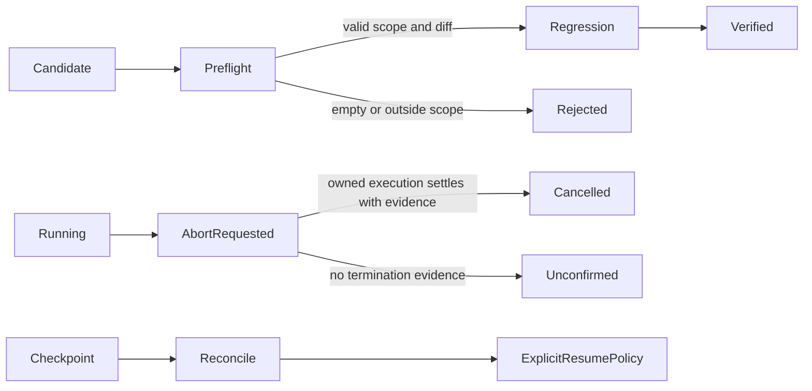

# MNEMOS Agent Runtime

Selected runtime components from **MNEMOS**, an independent AI orchestration project by [Andris Ziemelis](https://github.com/aziemels-byte).

This repository focuses on a practical harness problem: how to distinguish requested work, running work, verified results and uncertain termination. It contains a small, adapted code sample with tests and an executable example. It does not include the full MNEMOS system.

## Run it

Requires Node.js 22 or later. There are **no external runtime or development dependencies** and no API keys to configure.

```sh
npm test
npm run demo
npm run check:publication
node examples/lease-and-idempotency.mjs
node examples/quality-gate.mjs
node examples/cross-process.mjs
```

The demo creates a temporary workspace, rejects an empty candidate without starting regression, and validates an actual code change in a child Node.js process. It then starts a durable job whose command runs a small **process tree** (a command and its grandchild) under supervision, cancels it and verifies that the whole tree stopped, saves a checkpoint, and launches a **fresh Node.js process** that recovers the goal from the checkpoint and the job records and explicitly retries under a new job ID to complete a report. On Windows the tree's termination cannot be verified, so the recovered attempt is `UNKNOWN` and the demo reconciles it with evidence it checks itself before retrying. It cleans up its temporary files.

`examples/cross-process.mjs` starts four worker **processes** that share one state directory. They take turns on an exclusive `gpu:0` lease, kept alive by `keepLeaseAlive`, and report each use to the parent, which owns the resource and admits it with a `FencingGuard`. All four then request the same report at the same moment through `FileIdempotencyRegistry`; it is produced once. Finally all four save a shared checkpoint at the same moment; each `CHECKPOINT_CONFLICT` is recovered and merged, so no worker's update is lost. The parent verifies these outcomes and prints a summary; which worker wins each race varies between runs.

## Components

| Component | Responsibility | Important boundary |
| --- | --- | --- |
| `createCandidateVerifier` | Validate allowed paths and a non-empty candidate before regression | The workspace adapter must report every changed path; the verifier is not a filesystem sandbox |
| `PhaseJobRegistry` | Track job identity and execution phase; propagate abort; wait for an owned settlement | A cancellation request or timeout alone is not confirmed termination |
| `FilePhaseJobRegistry` | The same job contract with identity and status recorded on disk, so they survive a restart and are shared by processes on one host; evidence-based reconciliation; explicit resumption from saved progress | Same-host file lock; a restart never replays a job; a job whose owner died becomes `UNKNOWN` (or `CANCELLED` if never dispatched) until reconciled |
| `classifyProviderFailure` | Separate authentication, quota, model, timeout and transport failures; redact known credential patterns | It never retries, changes accounts or silently selects another model |
| `GoalRecoveryCoordinator` | Restore a checkpoint and reconcile each recorded job, with job status from `FilePhaseJobRegistry.jobInspector()` | Restoring state never automatically replays a task |
| `spawnSupervised`, `runSupervised` | Run a command as a supervised process tree that never outlives its owner; stop it with a termination receipt that is confirmed only when the whole tree is verifiably gone | Linux covers descendants that leave the process group; other POSIX systems cover the group; Windows receipts are never confirmed |
| `FileCheckpointStore` | Bound JSON size and atomically replace a checkpoint file; compare-and-swap on the last-read revision (on by default through `GoalRecoveryCoordinator`) | Writes are serialized across processes on one host; reads take no lock; not a multi-host store |
| `IdempotencyRegistry` | Journal effect intent and prevent ambiguous retries | Single process: durable safety requires a caller-provided persistent journal, which must not be shared by concurrently running processes; external reconciliation is required for UNKNOWN |
| `FileIdempotencyRegistry` | The same rules, shared by processes on one host: at most one start per key | Same-host file lock; results must be JSON (≤ ~1 MiB); ambiguous outcomes are UNKNOWN until reconciled, never re-run |
| `ResourceLeaseManager` | Reserve named resources exclusively with expiring leases | Single-process registry; not a distributed lock or permission to execute compute |
| `FileResourceLeaseManager` | Share the same exclusive leases between processes on one host through a state directory | Same-host, local-filesystem lock; not a multi-host or network-filesystem lock, nor permission to execute compute |
| `FencingGuard` | Reject writes from a lease holder that has been superseded | Must run inside the resource owner and be checked in the same step as the write; in-memory |
| `keepLeaseAlive` | Renew a held lease and abort a signal when it is lost | Advisory; never reacquires; a paused holder cannot observe the signal |
| `QualityGate` | Fail-closed evaluation of candidate test receipts and regression metrics | Read-only decision; human review is mandatory and supplied evidence is not authenticated |
| `QualityFloorPolicy` | Propose routes meeting a minimum expected quality threshold | Does not execute providers or validate forecast calibration |



## Example API

```js
import { createCandidateVerifier } from './src/index.mjs';

// Your runner must wait for actual exit and return { passed, exitCode }.
const verify = createCandidateVerifier({ runRegression: runYourTestRunner });

const result = await verify({
  workspace: yourWorkspaceAdapter,
  allowedFiles: ['src/task.mjs'],
  signal: yourAbortController.signal
});
```

The snippet shows the interface. The [runnable example](examples/verify-candidate.mjs) supplies a real file adapter and executes a real regression check. A production adapter must include tracked changes, deletions, renames and untracked files in its inventory, using repository-relative forward-slash paths. A `passed` flag without a zero exit code does not verify a candidate.

## Additional safety examples

Run `node examples/lease-and-idempotency.mjs` for a synthetic resource lease and a deduplicated operation. The idempotency adapter accepts `appendEvent(type, key, { record })` and `listEvents({ typePrefix })`; records may include results and must be kept in private storage. No store means process-local deduplication only. A journal shared by processes that run at the same time is not safe: each process decides from its own memory, so two of them can run the same key, and `restore()` marks another process's live execution as interrupted. Use `FileIdempotencyRegistry` for that (below). Request fingerprints are based on JSON serialization, so callers must use stable request shapes.

Within one registry instance, `restore()` rejects while execution, reconciliation or another restore is running. Until restoration finishes (including recovery journal writes), `execute()` and `reconcile()` reject. Reconciliation rejects for an executing key and reserves its key until its journal write settles; execution and other reconciliations for that key reject during that interval. These busy errors leave the existing state intact. Callers should await the active transition before explicitly retrying the rejected call. Executions for independent keys can still overlap, and matching concurrent executions share one effect.

The lease manager requires a `nodeRegistry.require(nodeId)` adapter whose nodes declare VERIFIED trust and AVAILABLE status. Leases are exclusive per node and resource and require explicit caller authorization. Resource IDs are compared case-insensitively and returned in lower case, so `GPU:0` and `gpu:0` are the same resource. `ResourceLeaseManager` keeps leases in memory and coordinates only callers within one process. It is not a remote permission grant or GPU scheduler.

For processes on the same host, use `FileResourceLeaseManager({ directory, nodeRegistry })`. It has the same methods and policy, but every method returns a promise and runs as a transaction: take the directory lock, load `leases.json`, apply the policy, atomically replace the state and unlock. Every process must use the same owner-controlled directory on a local filesystem that supports exclusive hard links.

- A lock is removed by another process only when its holder ran on the same host and its PID no longer exists. A lock held by another host, a live or reused PID, or an unreadable record is never broken; callers instead get `LEASE_LOCK_TIMEOUT` after `lockTimeoutMs` (default 5 s). Processes that share a directory but not a PID namespace (for example separate containers) must not share a lease directory.
- A process killed mid-transaction leaves its lock behind; the next caller removes it once that PID is gone. Temporary files left by a crashed writer are swept by the next transaction, and files belonging to processes that may still be running are kept.
- If a process dies in the short window while it is clearing another process's stale lock, the lock stays until an operator clears it with `forceUnlock()` (see the runbook below). Calls fail with `LEASE_LOCK_TIMEOUT` until then. Staying stuck is deliberate: automatically clearing that state could grant one resource twice.
- A crash is never a release: the lease stands until its TTL expires.
- Unreadable or invalid lease state is rejected with `LEASE_STATE_INVALID` and is never treated as empty, because that would grant held resources again.
- Expiry uses each process's clock, so the processes must share a host clock.
- A process that is paused (not killed) while holding the directory lock blocks every lease operation, which fail with `LEASE_LOCK_TIMEOUT` until it resumes. Its lock is not broken because the process is still alive. The lock is held only for one short transaction.

### Fencing tokens

A lease can expire while its holder is paused (GC pause, suspended VM, `SIGSTOP`), and a lease check made before acting cannot prevent a write afterwards. Every lease therefore carries a `fencingToken`: an integer that increases on every grant, is kept by `renew()`, and is never reused. With `FileResourceLeaseManager` the counter lives in `leases.json` and survives releases and restarts; `snapshot().lastFencingToken` reports it.

Leases alone cannot enforce this; the protected resource must. Pass the token with every write and check it with `FencingGuard` in the process that owns the resource:

```js
import { FencingGuard } from './src/index.mjs';

const guard = new FencingGuard({ floor: (await leases.snapshot()).lastFencingToken });
function applyWrite({ fencingToken, data }) {
  guard.admit('local/gpu:0', fencingToken); // throws FENCE_STALE for a superseded holder
  commit(data);                              // same synchronous step: no await in between
}
```

- `admit(key, token)` accepts a token equal to or newer than the highest seen for that key and rejects older ones with `code: 'FENCE_STALE'`. Use one key per protected node/resource.
- The guard is in-memory. After the resource owner restarts, seed `floor` from `lastFencingToken`. This fails closed: holders of older, still-valid leases are rejected and must reacquire.
- Never delete or reset `leases.json` while any holder could still act. Restarting the counter would let an old holder's higher token beat new holders.
- Fencing protects only resources that check the token. Effects with no such check (an external API, a GPU kernel already running) are not fenced.

### Keeping a lease alive

`keepLeaseAlive()` renews a lease on a timer and reports loss through an `AbortSignal`. It works with both lease managers:

```js
import { keepLeaseAlive } from './src/index.mjs';

const keeper = keepLeaseAlive({ manager: leases, lease, ownerId: lease.ownerId, ttlMs: 30_000,
  explicitAuthorization: true, onLost: () => jobs.requestCancellation(jobId) });
// pass keeper.signal to the work; write with keeper.lease.fencingToken
await keeper.stop({ release: true });
```

- The lease counts as lost when a renewal fails, or when a local deadline passes. The deadline is measured from the start of the last successful renewal request, minus `safetyMarginMs` (default TTL/10), so a renewal that hangs or completes late cannot extend it. Renewals run every `renewEveryMs` (default TTL/3).
- On loss the signal aborts once with `code` `LEASE_RENEWAL_FAILED` or `LEASE_DEADLINE_PASSED`, and `onLost` runs once. Neither happens after `stop()`. The keeper never reacquires.
- The signal is advisory. A paused process cannot observe it, so writes must still be fenced.

### Checkpoint coordination across processes

Several processes can share one checkpoint directory. Each save takes the directory lock (`checkpoint.lock`). A checkpoint's **revision** is the SHA-256 of its stored bytes, so the file format is unchanged and checkpoints written by earlier versions work as they are.

```js
const recovered = await coordinator.recover();          // the coordinator remembers checkpointRevision
await coordinator.checkpoint({ goal, activeJobs });     // replaces only that revision
// throws code CHECKPOINT_CONFLICT if another process saved in between
```

- **By default, `GoalRecoveryCoordinator.checkpoint()` replaces only the checkpoint that coordinator last saw**: the revision from its last `recover()` or `checkpoint()`. A coordinator that has seen none may only create a checkpoint. Checkpoint writes on one coordinator are applied in call order.
- While recovery is in progress, or after it overlapped another recovery or an explicit save, a default save fails with `CHECKPOINT_REVISION_REQUIRED`. Pass `expectedRevision` from the exact snapshot you used, or await a fresh recovery on its own to restore default saves. `lastKnownRevision` still shows the last observed or stored revision. It can differ from the revision of an earlier returned snapshot.
- After `CHECKPOINT_CONFLICT` the coordinator keeps refusing until it calls `recover()` again, so a stale view is never adopted silently.
- `expectedRevision` overrides the tracked revision. `unconditional: true` is the explicit opt-out (last writer wins), for example to replace an unreadable checkpoint after investigation.
- At the store level, `store.save(value, { expectedRevision })` writes only if the stored checkpoint still has that revision; `null` means "only if none exists". `store.save(value)` without options is unconditional, as before.
- On `CHECKPOINT_CONFLICT`, nothing is written. Reload, reconcile and decide again; never retry blindly with the new revision.
- `store.read()` returns `{ value, revision }`; `save()` resolves to `{ revision }`. `recover()` reports `checkpointRevision` for invalid checkpoints too, so they can be replaced conditionally.
- Reads never take the lock: a stuck lock blocks saves (`CHECKPOINT_LOCK_TIMEOUT`) but never recovery reads.
- Custom stores without `read()` keep working. Passing `expectedRevision` to them throws instead of silently ignoring the condition.
- Lease and checkpoint state may share a directory; each lock cleans up only its own files.

### Idempotency across processes

`FileIdempotencyRegistry({ directory })` applies the `IdempotencyRegistry` rules, with state shared by every process that uses the directory. It needs no journal adapter and no `restore()`: each call reads the current record.

```js
const effects = new FileIdempotencyRegistry({ directory: stateDirectory });
const outcome = await effects.execute({ key: 'payment:42', request, operation: () => charge(request) });
// IDEMPOTENCY_EXECUTED | IDEMPOTENT_REPLAY | IDEMPOTENCY_IN_PROGRESS | IDEMPOTENCY_UNKNOWN | IDEMPOTENCY_FAILED | IDEMPOTENCY_CONFLICT
```

- Under the directory lock (`idempotency.lock`), `execute()` checks the key and records `STARTED` with its owner (PID, host, execution ID) before the effect runs. The effect runs without the lock; its outcome is recorded in a second short transaction.
- While the owner is alive, other processes get `IDEMPOTENCY_IN_PROGRESS` (a new status; nothing runs) and `reconcile()` rejects. Retry later to get the replayed result. Within one registry instance, overlapping calls still share one execution.
- Only a provably dead owner turns `STARTED` into `UNKNOWN` (reason `INTERRUPTED_AFTER_EFFECT_START`), so a live execution is never reported as interrupted. An owner on another host, or a dead owner whose PID now belongs to another running process, keeps the key `IN_PROGRESS`. That fails closed; see the operator override below.
- If an outcome cannot be recorded (for example a result that is not JSON, or a disk error), the key becomes `UNKNOWN`. If even that write fails (for example the lock is blocked), it is retried in the background with backoff (25 ms up to 2 s) while the process runs, so other processes do not see the key `IN_PROGRESS` for the rest of the owner's lifetime. The retry never replaces a record someone else has resolved, and never keeps a finished process alive. Unreadable or mismatched records fail with `IDEMPOTENCY_STATE_INVALID` and are never treated as absent, because that would run the effect again.
- `inspect(key)` returns a record with its owner's state; `snapshot()` counts records by state. Records keep results on disk: use a private, owner-controlled directory.

### Operator runbook: a key stuck IN_PROGRESS

If a key stays `IDEMPOTENCY_IN_PROGRESS` although its owner is known to be gone (its PID was reused by another process, or it ran on another host), establish the effect's real outcome from an authoritative source, then:

```js
const record = await effects.inspect(key);   // owner: { pid, host, executionId }, ownerState
await effects.reconcile({ key, request, disposition: 'COMPLETED', result, evidence: { authoritative: true, source },
  expectedExecutionId: record.owner.executionId, explicitAuthorization: true });
```

- The override applies only to that exact execution (`IDEMPOTENCY_RECORD_CHANGED` otherwise; inspect again) and is refused for an execution running in the calling process. Authoritative evidence is still required.
- The reconciled record keeps a `liveOwnerOverride` entry (execution, owner, time) for audit.
- If the owner was in fact still running, its later outcome write is refused: the reconciled record stands and that owner's `execute()` rejects with `IDEMPOTENCY_UNKNOWN`.

### Supervised process trees

Stopping a child process does not stop its children. `spawnSupervised()` runs a command as the leader of a new process group, under a small supervisor process, and stops the whole tree:

```js
import { spawnSupervised, runSupervised, PhaseJobRegistry } from './src/index.mjs';

const tree = await spawnSupervised('make', ['test'], { stdio: 'inherit' });
const receipt = await tree.terminate({ graceMs: 5_000, killWaitMs: 5_000 });
// { confirmed, coverage, signals, frozen, survivors, tracked, marker, leaderExit, ... }

// As a job executor: abort stops the tree; the receipt decides CANCELLED or UNKNOWN.
const jobs = new PhaseJobRegistry({ execute: ({ signal }) => runSupervised({ command: 'make', args: ['test'], signal }) });
```

- `terminate()` freezes the tree (SIGSTOP, rescanning until no new process appears), sends SIGTERM (and SIGCONT, so handlers run), waits `graceMs`, freezes again and sends SIGKILL. While waiting it rescans, so a process started by a SIGTERM handler is stopped too. `confirmed` is true only when the group is empty, every process found is gone and a fresh scan finds nothing running; exited processes awaiting reaping count as gone.
- The tree never outlives its owner: the supervisor runs in its own session, connected to the owner by an IPC channel. When the owner exits, crashes or is killed (even with SIGKILL, or its whole process group), the supervisor stops the tree. Members left in the group after the command ended are stopped when the owner exits.
- On Linux the supervisor also follows parent links in `/proc` every `trackIntervalMs` (default 250 ms), and every command carries an environment marker (`MNEMOS_TREE_<id>=1`, in `receipt.marker` and `tree.marker`) that its descendants inherit. Descendants that start their own session or group are found and stopped either way (`coverage: 'process-group+descendants'`). Process IDs are checked against their start time before any signal, so a reused PID is never signalled.
- `beforeStart({ supervisor, marker })` runs before the command starts (if it throws, or the owner dies first, the command never starts); `onStart({ pid, identity, marker })` runs once it runs. `runSupervised` reports `COMPLETED` or `FAILED` by exit code when the command ends by itself (and stops what it left in its group), `CANCELLED` with the receipt on abort, and `effectAbsent: true` when the command never started.
- Limits: on Linux, a process that clears its environment, leaves the group and loses its parent before any scan sees it cannot be found. Other POSIX systems cover the process group only. Windows has no process groups: the tree is stopped with `taskkill /T`, which cannot reach descendants whose parent already exited, so receipts are never confirmed there. Only processes of the same user can be inspected. Each supervisor is a Node.js process (about 100 ms to start). Piped `stdout`/`stderr` streams keep the owner alive until they are consumed or closed, as with any child process.

### Job status across restarts

`FilePhaseJobRegistry({ directory, execute })` runs jobs with the `PhaseJobRegistry` contract (`execute({ jobId, objective, input, signal, setPhase })`), but records each job in `directory` so that its identity and status survive a process restart, a crash or a power loss. Every method returns a promise.

```js
const jobs = new FilePhaseJobRegistry({ directory: stateDirectory, execute });
await jobs.start({ jobId: 'report_1', objective: 'Create the report', input });  // recorded before it resolves
const settled = await jobs.wait('report_1');                                     // outcome recorded before it resolves
// After a restart, in any process using the same directory:
await new FilePhaseJobRegistry({ directory: stateDirectory, execute }).get('report_1');  // same status, never re-run
```

- Records are written ahead of the work: `start()` records the job (`RUNNING`, phase `queued`) before it resolves; `dispatched: true` is recorded before the executor is called; the outcome is recorded after the executor settles. If the dispatch cannot be recorded, the executor is not called and the job is `FAILED` with `effectAbsent: true` (`DISPATCH_NOT_RECORDED`).
- A job ID runs at most once, across processes and restarts. Starting an existing ID returns its recorded state; a different objective or input is refused with `JOB_IDENTITY_CONFLICT`. A retry is a new job ID.
- Phase changes are recorded in the background, in order and coalesced, so `setPhase()` never blocks the executor; after a crash the recorded phase may lag behind. A cancellation request is recorded in order before the outcome, without delaying the abort.
- Outcomes follow `PhaseJobRegistry`. Each carries a `reason`. `effectAbsent: true` (a retry is safe) is recorded only when the executor explicitly returns it with `FAILED` or a confirmed `CANCELLED`, or when the executor was never called. A thrown error never proves that nothing happened and is never recorded.
- If an outcome cannot be recorded, this process reports the job `UNKNOWN` (`OUTCOME_NOT_RECORDED`) and keeps retrying in the background. After a restart, the record is what counts.
- Results are recorded only as plain JSON of at most 64 KiB; anything else is dropped (`resultDiscarded: true`) without changing the status. Inputs are not recorded, only their fingerprint.
- Unreadable or inconsistent records fail with `JOB_STATE_INVALID` and are never treated as absent or overwritten. `list()` returns every job and the files it could not read.
- `maxRunning` (default 64) bounds the jobs executing in one instance (`JOB_CAPACITY_EXHAUSTED`).
- Only the instance that runs a job can abort it; elsewhere `requestCancellation()` fails with `JOB_NOT_OWNED` (with `owner` and `ownerState`).
- Executors also receive `runProcess({ command, args, cwd, env, stdio, graceMs, killWaitMs })`, which runs a command as a [supervised process tree](#supervised-process-trees) tied to the job: it is aborted with the job, never outlives the registry's process, and resolves to `{ status: 'COMPLETED' | 'FAILED' | 'CANCELLED', ... }` with a termination receipt that is `confirmed` only when the whole tree is verifiably gone (on Linux including descendants that left the process group; on Windows never). Before the command starts, the tree's environment marker and its supervisor are recorded in the job's `processes`, and its leader once it runs; if that record cannot be written, the command does not start (`FAILED`, `effectAbsent: true`).

#### After a restart

Call `recover()` once at startup. It resolves every recorded job and never runs one:

```js
const { jobs, invalid, reclassified, unrecorded, unverified, orphaned, resumable, resumeIncomplete } = await jobs.recover();
```

| Recorded state | Owner | Reported and recorded |
| --- | --- | --- |
| `COMPLETED`, `FAILED`, `CANCELLED`, `UNKNOWN` | any | Unchanged |
| `RUNNING` | alive (`ownerState: 'ALIVE'`) | `RUNNING` |
| `RUNNING`, with recorded processes still running | provably gone | `RUNNING`, `ownerState: 'DEAD'`, `orphaned: true`; listed in `orphaned` (see below) |
| `RUNNING`, never dispatched | provably gone | `CANCELLED`, `effectAbsent: true`, reason `OWNER_DIED_BEFORE_DISPATCH` (the executor was never called) |
| `RUNNING`, dispatched | provably gone | `UNKNOWN`, `reconciliationRequired: true`, reason `OWNER_DIED_AFTER_DISPATCH` |
| `RUNNING` | on another host, or unreadable (`OTHER_HOST`, `UNREADABLE`) | `RUNNING`; listed in `unverified` for an operator to reconcile |

- An owner is provably gone when it ran on this host and its PID no longer exists, or when the record names this process's PID with an execution this process is not running (an earlier process had the same PID). Registry instances in one process see each other's jobs as alive.
- `get()`, `list()`, `start()`, `wait()` and `requestCancellation()` apply the same rules whenever they meet such a job, so `recover()` is a summary, not a precondition. The reclassification is recorded by compare-and-swap under the lock: every process agrees, it happens once, and a later reuse of the PID cannot make the job look alive again. If it cannot be recorded yet (for example `JOB_LOCK_TIMEOUT`), the job is reported `UNKNOWN` with reason `OWNER_DIED_NOT_RECORDED`, listed in `unrecorded`, and the next read tries again.
- `wait(jobId, { timeoutMs })` also follows jobs owned by other instances or processes, polling their record every `pollIntervalMs` (default 50 ms) until they are no longer `RUNNING`, including when their owner dies. Without `timeoutMs` it waits indefinitely, also for an owner on another host; with it, it resolves to the current state, which may still be `RUNNING`.
- On Linux, each job records its owner's boot ID and process start time. An owner is then also provably gone when the host has rebooted since, or when its PID now belongs to a process that started at another time (PID reuse). Elsewhere, and for records written without this identity, an unrelated process that reuses a dead owner's PID before the job is reclassified makes the owner look alive; the job then stays `RUNNING` until an operator reconciles it with `overrideRunningOwner: true`. Processes must share a PID namespace (see [Coordination guarantees](#coordination-guarantees)).

#### Orphaned processes

A process tree started with `runProcess` is stopped by its supervisor when the registry's process dies. If the supervisor dies too (both killed at once, or by the OOM killer), the tree can keep running. A job whose owner is gone is therefore checked against its recorded trees: while a recorded supervisor or leader is verifiably the same process, or (Linux) a process carries a tree's environment marker, the job stays `RUNNING` with `orphaned: true` and `processesState: 'RUNNING'`, because its work is running. A recorded PID that runs but cannot be verified (other platforms) gives `processesState: 'UNVERIFIED'`. Once nothing runs, the job is reclassified as above. `reconcile()` refuses such a job with `JOB_PROCESSES_RUNNING` unless you confirm the work has stopped with `overrideRunningOwner: true` (recorded).

```js
const job = await jobs.get('deploy');                          // RUNNING, orphaned: true
const { confirmed, receipts } = await jobs.terminateOrphans({
  jobId: 'deploy', expectedSequence: job.sequence, explicitAuthorization: true });
// confirmed: UNKNOWN, reason ORPHANS_TERMINATED, orphanTermination: { at, receipts }; then reconcile as usual
```

- Linux only (`JOB_ORPHANS_UNSUPPORTED` elsewhere). Each recorded tree is frozen, terminated and verified like `terminate()`: its process group only while the group ID verifiably still names it (its leader is the same process, or a member carries the marker), and every process carrying its marker, wherever it went. A supervisor still running is killed first. Reused PIDs are never signalled.
- Only a confirmed stop is recorded. Otherwise nothing is recorded and the job stays `RUNNING` (or is reclassified once its processes are gone).
- Refused without `explicitAuthorization` or with a stale `expectedSequence`, for a job whose owner runs (`JOB_NOT_OWNED`: its supervisor is in charge) and for jobs that are not `RUNNING` or recorded no processes (`JOB_NO_ORPHANS`).

#### Reconciling a job

`UNKNOWN` jobs, and `RUNNING` jobs whose owner cannot be verified, stay that way until someone with authoritative evidence decides their outcome. Reconciliation never runs the job.

```js
const job = await jobs.get('charge_attempt_1');                 // inspect first
await jobs.reconcile({
  jobId: 'charge_attempt_1',
  expectedSequence: job.sequence,                                 // the state you inspected
  disposition: 'FAILED',                                          // COMPLETED, FAILED or CANCELLED
  evidence: { authoritative: true, source: 'billing-api:charge/42', effectAbsent: true },
  explicitAuthorization: true
});
// Retry, if your policy allows it, under a new ID: jobs.start({ jobId: 'charge_attempt_2', ... })
```

- `expectedSequence` is compare-and-swap: if anything wrote since you inspected, including the owner, the call fails with `JOB_RECORD_CHANGED`; inspect again. Concurrent reconciliations of one state: exactly one succeeds.
- `evidence` must be plain JSON of at most 8 KiB with `authoritative: true` and a `source` naming the authority (`JOB_EVIDENCE_REQUIRED` otherwise). It is recorded for audit; do not put credentials in it. `effectAbsent: true` in the evidence marks a `FAILED` or `CANCELLED` job safe to retry; a `COMPLETED` job never is. A `result` (plain JSON, at most 64 KiB) may be recorded.
- A job that was never dispatched cannot be reconciled as `COMPLETED` (`JOB_TRANSITION_INVALID`): its executor was never called.
- `UNKNOWN` jobs and `RUNNING` jobs whose owner is provably gone need nothing more. A `RUNNING` job whose owner is alive elsewhere or cannot be verified is refused with `JOB_OWNER_UNVERIFIED` (with `ownerState` and `owner`) unless you confirm it has stopped and pass `overrideRunningOwner: true`; the override is recorded. If that owner was in fact still running, its later outcome is refused: the reconciliation stands, and the owner's `wait()` reports the reconciled record.
- A job executing in the calling process is never reconciled (`JOB_RUNNING_HERE`). A job with a definite outcome is final (`JOB_RECONCILIATION_NOT_REQUIRED`).
- The record keeps a `reconciliation` entry: time, disposition, evidence, the previous status and reason (and owner state), and any override.

#### Resuming a job from its saved progress

A job started with `resumable: true` can save its progress and, once it has stopped, be continued by a new attempt from that point instead of from the beginning. Resumption is never automatic.

```js
const jobs = new FilePhaseJobRegistry({ directory, execute: async ({ input, resume, saveProgress, effectKey }) => {
  for (let item = resume?.progress?.state.next ?? 0; item < input.items; item++) {
    await effects.execute({ key: effectKey(`item-${item}`), request: { item }, operation: () => importItem(item) });
    await saveProgress({ next: item + 1 });                       // durable before it resolves
  }
  return { status: 'COMPLETED' };
} });
await jobs.start({ jobId: 'import', objective: 'Import a batch', input, resumable: true });

// After a crash (the job is UNKNOWN), or after it was CANCELLED or FAILED:
const job = await jobs.get('import');
await jobs.resume({ jobId: 'import', expectedSequence: job.sequence, successorJobId: 'import_attempt_2',
  input, explicitAuthorization: true });
```

- `saveProgress(state)` records plain JSON of at most 64 KiB with the current phase; it resolves once durable. Only jobs started with `resumable: true` may call it (part of the job's identity).
- `resume()` accepts a resumable job that is `UNKNOWN`, `CANCELLED` or `FAILED` (never `COMPLETED`) whose stop is verified: it is not `RUNNING`, no process it recorded may still run, and it was not settled over an owner that may still run it (`JOB_STOP_UNVERIFIED` otherwise). `input` must be the job's input again (only its fingerprint is stored). The successor ID is yours; it must be new.
- Under one lock the job is linked to its successor (`resumedBy`; an `UNKNOWN` job becomes `CANCELLED` with reason `RESUMED`, while `CANCELLED` and `FAILED` keep their outcome) and the successor is recorded with `resumeOf: { jobId, rootJobId, attempt }` and the saved progress. It runs in the calling registry; its executor receives `resume: { fromJobId, rootJobId, attempt, progress }`. A job is resumed once: concurrent resumes produce one attempt (`JOB_ALREADY_RESUMED`, `JOB_RECORD_CHANGED`).
- Any effect after the last saved progress may already have happened. `effectKey(name)` is `<rootJobId>:<name>` in every attempt: use it with `FileIdempotencyRegistry` so that a completed effect is replayed rather than repeated, and an effect interrupted mid-way is `UNKNOWN` rather than run again. Effects that are neither keyed nor idempotent are the executor's responsibility.
- If a crash comes between the two writes, the job is linked to a successor that does not exist: `recover()` lists it in `resumeIncomplete`, and calling `resume()` again with the same `successorJobId` completes it. `recover()` also lists the candidates in `resumable`. `jobInspector()` follows `resumedBy` to the latest attempt, so a checkpoint can keep listing the original job ID.
- The in-memory `PhaseJobRegistry` does not resume.

#### Recovering a goal: checkpoints and job records together

A checkpoint records a goal, its DAG and which jobs belong to it. The job records are the source of truth for each job's status. Connect them with the registry's inspector:

```js
const jobs = new FilePhaseJobRegistry({ directory: stateDirectory, execute });
const coordinator = new GoalRecoveryCoordinator({ store: new FileCheckpointStore(stateDirectory),
  jobInspector: jobs.jobInspector() });

await jobs.start({ jobId: 'deploy', objective: 'Deploy release 1' });              // recorded first
await coordinator.checkpoint({ goal, dag, activeJobs: [{ id: 'build' }, { id: 'deploy' }] });

// After a restart:
const recovered = await coordinator.recover();
// recovered.jobs[i]: { id, recoveryStatus, recoveryReason, recoveryEffectAbsent, checkpointStatusStale, ... }
```

- Each checkpointed job is resolved like `jobs.get()`: a job whose owner died is reclassified and recorded (`OWNER_DIED_AFTER_DISPATCH`, `OWNER_DIED_BEFORE_DISPATCH`), reconciled jobs report `RECONCILED`, and nothing is ever run. `recoveryRequired` is true until every job is `COMPLETED`.
- A checkpointed job with no record is `UNKNOWN` with `recoveryReason: 'JOB_RECORD_MISSING'`: it may never have started, or its record was lost, and only evidence outside this store can tell. An unreadable record is `UNKNOWN` with `JOB_STATE_INVALID`.
- Start a job before listing it in a checkpoint. A job started but not yet checkpointed is not lost: `jobs.recover()` lists every recorded job.
- `recoveryReason` is the inspector's reason (an upper-case code), or why the inspection failed. `recoveryEffectAbsent` is true only for a `FAILED` or `CANCELLED` job the inspector reports as effect-free, so a retry under a new job ID is safe.
- A `status` (or `phase`) stored with a job in the checkpoint is only a hint and never decides recovery. `checkpointStatusStale` is true when it disagrees with the inspection. New checkpoints may not store a status or phase that no job can have; older checkpoints with such values still load.

### Operator runbook: a stuck lock

The lease manager (`leases.lock`), checkpoint store (`checkpoint.lock`), file idempotency registry (`idempotency.lock`) and file job registry (`jobs.lock`) use the same lock and the same recovery procedure. When calls keep failing with `LEASE_LOCK_TIMEOUT`, `CHECKPOINT_LOCK_TIMEOUT`, `IDEMPOTENCY_LOCK_TIMEOUT` or `JOB_LOCK_TIMEOUT`, start with the error itself: it carries `holder`, `holderState`, `lockId` and `pendingBreaks` from the moment of the timeout, and its message names the next step from the table below. To look again later, inspect the lock (read-only; it never takes the lock):

```js
const state = await leases.inspectLock();   // or checkpointStore.inspectLock()
// { status: 'LOCKED', lockId, holder: { pid, host, lockedAt, token }, holderState, pendingBreaks }
```

| `holderState` | Meaning | Action |
| --- | --- | --- |
| `ALIVE` | The holder is running on this host, possibly paused | Wait, or stop that process. `forceUnlock` refuses. |
| `DEAD` | The holder exited | Normally cleared automatically. If a `pendingBreaks` entry is `DEAD` too, a breaker died mid-recovery: use `forceUnlock`. |
| `OTHER_HOST` | Written from another host; cannot be checked | Confirm that process is gone, then use `forceUnlock`. Hosts must not share a lease directory. |
| `UNREADABLE` | The lock record is damaged | Confirm no lease operation is running, then use `forceUnlock`. |

```js
await leases.forceUnlock({ expectedLockId: state.lockId, explicitAuthorization: true });   // or checkpointStore.forceUnlock(...)
```

`forceUnlock` removes the lock only if it is still byte-for-byte the one inspected (otherwise `LOCK_CHANGED`; inspect again). It refuses with `LOCK_HOLDER_ALIVE` or `LOCK_BREAK_IN_PROGRESS` while a live process owns the lock or is recovering it. It also removes the matching break claim. It never edits lease, checkpoint, idempotency or job records. Run one operator recovery at a time.

`ResourceLeaseManager.require()` (and the file-backed equivalent) returns a deep copy, as do the other lease lookup APIs. Changing a returned lease cannot change the registered owner, resource coverage or expiration; use the authorized `renew()` and `release()` methods to change a lease.


## Quality Gate

MNEMOS includes a standalone, **read-only** quality gate for agent-generated change candidates. The public extraction combines concepts from five private modules; it does not expose the production orchestration code.

```js
import { QualityGate } from './src/index.mjs';

const decision = new QualityGate().review({
  definition: {
    executionPolicy: { requiresIsolatedWorktree: true },
    approvalPolicy: { autoMerge: false }
  },
  checks: { unit: unitReceipt, integration: integrationReceipt,
    regression: regressionReceipt, benchmark: benchmarkReceipt,
    security: securityReceipt, recovery: recoveryReceipt },
  baseline: baselineMetrics,
  candidate: candidateMetrics
});
```

Each required receipt must contain `passed: true`, `completed: true`, `exitCode: 0` and a non-empty `evidenceId`. Metrics require equal positive sample counts, finite success rate, quality, cost and latency, and nonnegative regression counts. Only non-regressing candidates with all required receipts return `READY_FOR_HUMAN_REVIEW`. The optional release qualification checks eight additional categories with traceable evidence. `QualityFloorPolicy` proposes candidate routes above a configured quality threshold without executing any provider.

Run the synthetic example with `node examples/quality-gate.mjs`. The package does **not** run tests, authenticate external receipts, attest that a real worktree was isolated, establish benchmark equivalence, merge code or deploy changes. A trusted caller must supply real results and independently enforce policy; passing this gate is not a production safety certification.

## Coordination guarantees

What holds where. "One host" means processes on the same machine that share an owner-controlled state directory on a local filesystem.

| Guarantee | Within one process | Across processes on one host | Across hosts |
| --- | --- | --- | --- |
| Exclusive resource lease | `ResourceLeaseManager` | `FileResourceLeaseManager` (directory lock) | Not provided |
| A write with an older token is rejected after the resource accepts a newer token | `FencingGuard` at the resource | `FencingGuard` in the process that owns the resource; tokens come from the shared counter | Not provided |
| Holder learns it lost a lease | `keepLeaseAlive` signal (advisory; a paused process cannot see it) | Same | Not provided |
| A resumed job repeats no keyed effect | Not provided by `PhaseJobRegistry` | `resume()` with `effectKey()` and `FileIdempotencyRegistry` (completed effects replay; interrupted ones are `UNKNOWN`) | Not provided |
| Effect started at most once per key; ambiguous outcome never re-run | `IdempotencyRegistry` (overlapping calls share one run) | `FileIdempotencyRegistry` (others get `IN_PROGRESS`, then `REPLAY`) | Not provided |
| External effect exactly once | Not provided: an interrupted effect is `UNKNOWN` until authoritative reconciliation | Same | Not provided |
| Checkpoint never torn | `FileCheckpointStore` (atomic replace) | Same | Not provided |
| Checkpoint update never silently lost | `GoalRecoveryCoordinator` revision check (on by default) | Same, through the checkpoint lock | Not provided |
| Crashed lock holder recovered | Not applicable | Automatically when its PID is provably gone; otherwise operator runbook | Not provided |
| Crashed effect owner | Key becomes `UNKNOWN` after `restore()` from a persistent journal (in-memory state is lost) | Key becomes `UNKNOWN` once the owner's PID is provably gone; otherwise operator override | Not provided |
| Job status survives a restart; a job ID runs at most once | Not provided by `PhaseJobRegistry` (in-memory) | `FilePhaseJobRegistry` (directory lock, write-ahead records) | Not provided |
| A stopped command leaves no process behind | `spawnSupervised` / `runSupervised`: confirmed receipts (Linux: including descendants that left the group; other POSIX: the group; Windows: never confirmed) | Same; the tree never outlives its owner | Not provided |
| Crashed job owner | Not applicable | Never re-run. Once the owner's PID is provably gone: `UNKNOWN` if dispatched, `CANCELLED` if not; recorded once. While its recorded processes run: `RUNNING`, `orphaned`; `terminateOrphans()` (Linux) | Not provided |

Limits that apply to every row:

- A process counts as gone when it ran on this host and its PID no longer exists. On Linux, a process that has exited but was not yet reaped by its parent (a zombie) also counts as gone, so a slow or non-reaping init (for example a container without `--init`) cannot keep a dead holder's lock or job alive.
- A lock is never broken while its holder may be alive. A paused holder blocks that directory until it resumes; calls fail with a `*_LOCK_TIMEOUT` error that names the holder and the next step.
- Processes must share a host clock, a PID namespace and a local filesystem with atomic exclusive hard links. Separate containers or network filesystems must not share a state directory.
- Deleting or resetting state files (`leases.json`, idempotency and job records, checkpoints) while any process could still act voids these guarantees.
- CI exercises Node.js 22 and 24 on Linux and Windows.

## Design decisions and limits

- Cheap structural checks run before expensive tests. Malformed paths fail instead of disappearing from the allowed-scope check.
- Cooperative cancellation is distinct from killing an operating-system process. The registry trusts a caller-owned execution adapter's termination evidence. `runSupervised` and `runProcess` supply such evidence for local process trees (see their limits); remote jobs and effects are not covered.
- `PhaseJobRegistry` is in-memory: job status and job identity do not survive a process restart, and starting the same job ID in a new process runs it again. Use `FilePhaseJobRegistry` when they must. Within a process, only jobs with a definite outcome (`COMPLETED`, `FAILED`, confirmed `CANCELLED`) are evicted to make room; running jobs and `UNKNOWN` jobs are kept, so an ambiguous job is never started again. When they fill `maxEntries`, `start()` fails with `JOB_CAPACITY_EXHAUSTED` until `reconcile()` resolves some of them (same arguments as below, without `expectedSequence`). A result that cannot be copied is dropped (`result: null`, `resultDiscarded: true`) without changing the reported status.
- Job IDs are 1 to 128 letters, digits, `_` or `-`, starting with a letter or digit. The registry and checkpoints use the same rule.
- Checkpoints are versioned and bounded to 1 MiB. Malformed state and failed job inspection require reconciliation. Stored state is not an instruction to execute work.
- Each `jobInspector(job, { signal })` call is limited to `inspectionTimeoutMs` (default 10 s), and all inspections in one `recover()` to `recoveryTimeoutMs` (default 120 s). A job whose inspection fails, times out or returns an unsupported status, or that is not reached within the budget, is `UNKNOWN`, and `recoveryReason` says why (`INSPECTION_FAILED`, `INSPECTION_TIMEOUT`, `INSPECTION_UNSUPPORTED_STATUS`, `RECOVERY_TIMEOUT`). On timeout the signal aborts; an inspector that ignores it is abandoned, not awaited.
- State files (checkpoints, leases, idempotency and job records) use same-directory replacement of a flushed temporary file, then flush the directory so the replacement survives a power loss; a new state directory is also flushed into its parent. Windows cannot flush a directory, so there this relies on NTFS metadata journaling and is best effort. Saves are serialized across processes on one host by a directory lock. This is not a claim of multi-host durability, of durability on filesystems or disks that ignore flush requests, or of protection against an attacker controlling the state directory. Use an owner-controlled directory. Unix permission bits do not replace Windows ACLs.
- Diagnostic redaction recognizes selected credential patterns. It is best-effort and does not make arbitrary logs or personal data safe to publish.
- Coordination across processes is summarized in [Coordination guarantees](#coordination-guarantees). A successful remote resource lease does not permit remote execution by itself.
- No model quality, token savings, benchmark score or commercial production scale is claimed by this sample.

## Provenance

These modules were selected from MNEMOS execution, orchestration, recovery and diagnostic code, then adapted to remove private runtime dependencies and improve reviewability. The public APIs and tests differ from the private application. See [PROVENANCE.md](PROVENANCE.md) for the extraction boundaries and changes.

The project was developed with AI-assisted tooling. This sample is presented with runnable checks and explicit limitations; generated code alone is not validation.

## License

Copyright (c) 2026 Andris Ziemelis. The code and documentation published **in this repository** are licensed under the [MIT License](LICENSE). This license does not cover unpublished MNEMOS modules, private runtime data or the full MNEMOS application. The sample is not published to npm.
