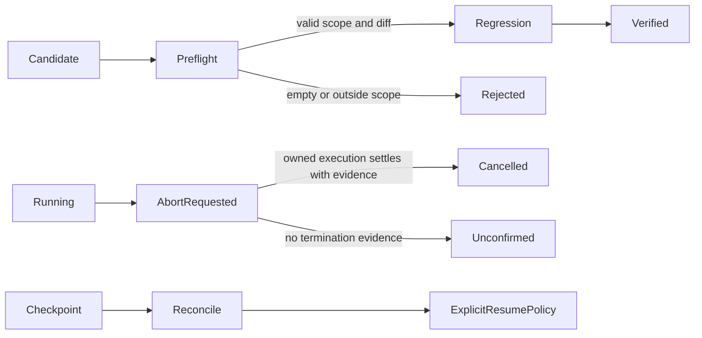

# MNEMOS Agent Runtime

Selected runtime components from **MNEMOS**, an independent AI orchestration project by [Andris Ziemelis](https://github.com/aziemels-byte).

This repository focuses on a practical harness problem: how to distinguish requested work, running work, verified results and uncertain termination. It contains a small, adapted code sample with tests and an executable example. It does not include the full MNEMOS system.

## Run it

Requires Node.js 22 or later. There are **no external runtime or development dependencies** and no API keys to configure.

```sh
npm test
npm run demo
npm run check:publication
node examples/lease-and-idempotency.mjs
node examples/quality-gate.mjs
node examples/cross-process.mjs
```

The demo creates a temporary workspace, rejects an empty candidate without starting regression, validates an actual code change in a child Node.js process, starts and cancels an owned child process, saves a checkpoint, and launches a **fresh Node.js process** to reconcile the cancelled attempt and explicitly complete a report. It cleans up its temporary files.

`examples/cross-process.mjs` starts four worker **processes** that share one state directory. They take turns on an exclusive `gpu:0` lease, kept alive by `keepLeaseAlive`, and report each use to the parent, which owns the resource and admits it with a `FencingGuard`. All four then request the same report at the same moment through `FileIdempotencyRegistry`; it is produced once. Finally all four save a shared checkpoint at the same moment; each `CHECKPOINT_CONFLICT` is recovered and merged, so no worker's update is lost. The parent verifies these outcomes and prints a summary; which worker wins each race varies between runs.

## Components

| Component | Responsibility | Important boundary |
| --- | --- | --- |
| `createCandidateVerifier` | Validate allowed paths and a non-empty candidate before regression | The workspace adapter must report every changed path; the verifier is not a filesystem sandbox |
| `PhaseJobRegistry` | Track job identity and execution phase; propagate abort; wait for an owned settlement | A cancellation request or timeout alone is not confirmed termination |
| `classifyProviderFailure` | Separate authentication, quota, model, timeout and transport failures; redact known credential patterns | It never retries, changes accounts or silently selects another model |
| `GoalRecoveryCoordinator` | Restore a checkpoint and reconcile each recorded job | Restoring state never automatically replays a task |
| `FileCheckpointStore` | Bound JSON size and atomically replace a checkpoint file; compare-and-swap on the last-read revision (on by default through `GoalRecoveryCoordinator`) | Writes are serialized across processes on one host; reads take no lock; not a multi-host store |
| `IdempotencyRegistry` | Journal effect intent and prevent ambiguous retries | Single process: durable safety requires a caller-provided persistent journal, which must not be shared by concurrently running processes; external reconciliation is required for UNKNOWN |
| `FileIdempotencyRegistry` | The same rules, shared by processes on one host: at most one start per key | Same-host file lock; results must be JSON (≤ ~1 MiB); ambiguous outcomes are UNKNOWN until reconciled, never re-run |
| `ResourceLeaseManager` | Reserve named resources exclusively with expiring leases | Single-process registry; not a distributed lock or permission to execute compute |
| `FileResourceLeaseManager` | Share the same exclusive leases between processes on one host through a state directory | Same-host, local-filesystem lock; not a multi-host or network-filesystem lock, nor permission to execute compute |
| `FencingGuard` | Reject writes from a lease holder that has been superseded | Must run inside the resource owner and be checked in the same step as the write; in-memory |
| `keepLeaseAlive` | Renew a held lease and abort a signal when it is lost | Advisory; never reacquires; a paused holder cannot observe the signal |
| `QualityGate` | Fail-closed evaluation of candidate test receipts and regression metrics | Read-only decision; human review is mandatory and supplied evidence is not authenticated |
| `QualityFloorPolicy` | Propose routes meeting a minimum expected quality threshold | Does not execute providers or validate forecast calibration |



## Example API

```js
import { createCandidateVerifier } from './src/index.mjs';

// Your runner must wait for actual exit and return { passed, exitCode }.
const verify = createCandidateVerifier({ runRegression: runYourTestRunner });

const result = await verify({
  workspace: yourWorkspaceAdapter,
  allowedFiles: ['src/task.mjs'],
  signal: yourAbortController.signal
});
```

The snippet shows the interface. The [runnable example](examples/verify-candidate.mjs) supplies a real file adapter and executes a real regression check. A production adapter must include tracked changes, deletions, renames and untracked files in its inventory, using repository-relative forward-slash paths. A `passed` flag without a zero exit code does not verify a candidate.

## Additional safety examples

Run `node examples/lease-and-idempotency.mjs` for a synthetic resource lease and a deduplicated operation. The idempotency adapter accepts `appendEvent(type, key, { record })` and `listEvents({ typePrefix })`; records may include results and must be kept in private storage. No store means process-local deduplication only. A journal shared by processes that run at the same time is not safe: each process decides from its own memory, so two of them can run the same key, and `restore()` marks another process's live execution as interrupted. Use `FileIdempotencyRegistry` for that (below). Request fingerprints are based on JSON serialization, so callers must use stable request shapes.

Within one registry instance, `restore()` rejects while execution, reconciliation or another restore is running. Until restoration finishes (including recovery journal writes), `execute()` and `reconcile()` reject. Reconciliation rejects for an executing key and reserves its key until its journal write settles; execution and other reconciliations for that key reject during that interval. These busy errors leave the existing state intact. Callers should await the active transition before explicitly retrying the rejected call. Executions for independent keys can still overlap, and matching concurrent executions share one effect.

The lease manager requires a `nodeRegistry.require(nodeId)` adapter whose nodes declare VERIFIED trust and AVAILABLE status. Leases are exclusive per node and resource and require explicit caller authorization. Resource IDs are compared case-insensitively and returned in lower case, so `GPU:0` and `gpu:0` are the same resource. `ResourceLeaseManager` keeps leases in memory and coordinates only callers within one process. It is not a remote permission grant or GPU scheduler.

For processes on the same host, use `FileResourceLeaseManager({ directory, nodeRegistry })`. It has the same methods and policy, but every method returns a promise and runs as a transaction: take the directory lock, load `leases.json`, apply the policy, atomically replace the state and unlock. Every process must use the same owner-controlled directory on a local filesystem that supports exclusive hard links.

- A lock is removed by another process only when its holder ran on the same host and its PID no longer exists. A lock held by another host, a live or reused PID, or an unreadable record is never broken; callers instead get `LEASE_LOCK_TIMEOUT` after `lockTimeoutMs` (default 5 s). Processes that share a directory but not a PID namespace (for example separate containers) must not share a lease directory.
- A process killed mid-transaction leaves its lock behind; the next caller removes it once that PID is gone. Temporary files left by a crashed writer are swept by the next transaction, and files belonging to processes that may still be running are kept.
- If a process dies in the short window while it is clearing another process's stale lock, the lock stays until an operator clears it with `forceUnlock()` (see the runbook below). Calls fail with `LEASE_LOCK_TIMEOUT` until then. Staying stuck is deliberate: automatically clearing that state could grant one resource twice.
- A crash is never a release: the lease stands until its TTL expires.
- Unreadable or invalid lease state is rejected with `LEASE_STATE_INVALID` and is never treated as empty, because that would grant held resources again.
- Expiry uses each process's clock, so the processes must share a host clock.
- A process that is paused (not killed) while holding the directory lock blocks every lease operation, which fail with `LEASE_LOCK_TIMEOUT` until it resumes. Its lock is not broken because the process is still alive. The lock is held only for one short transaction.

### Fencing tokens

A lease can expire while its holder is paused (GC pause, suspended VM, `SIGSTOP`), and a lease check made before acting cannot prevent a write afterwards. Every lease therefore carries a `fencingToken`: an integer that increases on every grant, is kept by `renew()`, and is never reused. With `FileResourceLeaseManager` the counter lives in `leases.json` and survives releases and restarts; `snapshot().lastFencingToken` reports it.

Leases alone cannot enforce this; the protected resource must. Pass the token with every write and check it with `FencingGuard` in the process that owns the resource:

```js
import { FencingGuard } from './src/index.mjs';

const guard = new FencingGuard({ floor: (await leases.snapshot()).lastFencingToken });
function applyWrite({ fencingToken, data }) {
  guard.admit('local/gpu:0', fencingToken); // throws FENCE_STALE for a superseded holder
  commit(data);                              // same synchronous step: no await in between
}
```

- `admit(key, token)` accepts a token equal to or newer than the highest seen for that key and rejects older ones with `code: 'FENCE_STALE'`. Use one key per protected node/resource.
- The guard is in-memory. After the resource owner restarts, seed `floor` from `lastFencingToken`. This fails closed: holders of older, still-valid leases are rejected and must reacquire.
- Never delete or reset `leases.json` while any holder could still act. Restarting the counter would let an old holder's higher token beat new holders.
- Fencing protects only resources that check the token. Effects with no such check (an external API, a GPU kernel already running) are not fenced.

### Keeping a lease alive

`keepLeaseAlive()` renews a lease on a timer and reports loss through an `AbortSignal`. It works with both lease managers:

```js
import { keepLeaseAlive } from './src/index.mjs';

const keeper = keepLeaseAlive({ manager: leases, lease, ownerId: lease.ownerId, ttlMs: 30_000,
  explicitAuthorization: true, onLost: () => jobs.requestCancellation(jobId) });
// pass keeper.signal to the work; write with keeper.lease.fencingToken
await keeper.stop({ release: true });
```

- The lease counts as lost when a renewal fails, or when a local deadline passes. The deadline is measured from the start of the last successful renewal request, minus `safetyMarginMs` (default TTL/10), so a renewal that hangs or completes late cannot extend it. Renewals run every `renewEveryMs` (default TTL/3).
- On loss the signal aborts once with `code` `LEASE_RENEWAL_FAILED` or `LEASE_DEADLINE_PASSED`, and `onLost` runs once. Neither happens after `stop()`. The keeper never reacquires.
- The signal is advisory. A paused process cannot observe it, so writes must still be fenced.

### Checkpoint coordination across processes

Several processes can share one checkpoint directory. Each save takes the directory lock (`checkpoint.lock`). A checkpoint's **revision** is the SHA-256 of its stored bytes, so the file format is unchanged and checkpoints written by earlier versions work as they are.

```js
const recovered = await coordinator.recover();          // the coordinator remembers checkpointRevision
await coordinator.checkpoint({ goal, activeJobs });     // replaces only that revision
// throws code CHECKPOINT_CONFLICT if another process saved in between
```

- **By default, `GoalRecoveryCoordinator.checkpoint()` replaces only the checkpoint that coordinator last saw**: the revision from its last `recover()` or `checkpoint()`. A coordinator that has seen none may only create a checkpoint. Checkpoint writes on one coordinator are applied in call order.
- While recovery is in progress, or after it overlapped another recovery or an explicit save, a default save fails with `CHECKPOINT_REVISION_REQUIRED`. Pass `expectedRevision` from the exact snapshot you used, or await a fresh recovery on its own to restore default saves. `lastKnownRevision` still shows the last observed or stored revision. It can differ from the revision of an earlier returned snapshot.
- After `CHECKPOINT_CONFLICT` the coordinator keeps refusing until it calls `recover()` again, so a stale view is never adopted silently.
- `expectedRevision` overrides the tracked revision. `unconditional: true` is the explicit opt-out (last writer wins), for example to replace an unreadable checkpoint after investigation.
- At the store level, `store.save(value, { expectedRevision })` writes only if the stored checkpoint still has that revision; `null` means "only if none exists". `store.save(value)` without options is unconditional, as before.
- On `CHECKPOINT_CONFLICT`, nothing is written. Reload, reconcile and decide again; never retry blindly with the new revision.
- `store.read()` returns `{ value, revision }`; `save()` resolves to `{ revision }`. `recover()` reports `checkpointRevision` for invalid checkpoints too, so they can be replaced conditionally.
- Reads never take the lock: a stuck lock blocks saves (`CHECKPOINT_LOCK_TIMEOUT`) but never recovery reads.
- Custom stores without `read()` keep working. Passing `expectedRevision` to them throws instead of silently ignoring the condition.
- Lease and checkpoint state may share a directory; each lock cleans up only its own files.

### Idempotency across processes

`FileIdempotencyRegistry({ directory })` applies the `IdempotencyRegistry` rules, with state shared by every process that uses the directory. It needs no journal adapter and no `restore()`: each call reads the current record.

```js
const effects = new FileIdempotencyRegistry({ directory: stateDirectory });
const outcome = await effects.execute({ key: 'payment:42', request, operation: () => charge(request) });
// IDEMPOTENCY_EXECUTED | IDEMPOTENT_REPLAY | IDEMPOTENCY_IN_PROGRESS | IDEMPOTENCY_UNKNOWN | IDEMPOTENCY_FAILED | IDEMPOTENCY_CONFLICT
```

- Under the directory lock (`idempotency.lock`), `execute()` checks the key and records `STARTED` with its owner (PID, host, execution ID) before the effect runs. The effect runs without the lock; its outcome is recorded in a second short transaction.
- While the owner is alive, other processes get `IDEMPOTENCY_IN_PROGRESS` (a new status; nothing runs) and `reconcile()` rejects. Retry later to get the replayed result. Within one registry instance, overlapping calls still share one execution.
- Only a provably dead owner turns `STARTED` into `UNKNOWN` (reason `INTERRUPTED_AFTER_EFFECT_START`), so a live execution is never reported as interrupted. An owner on another host, or a dead owner whose PID now belongs to another running process, keeps the key `IN_PROGRESS`. That fails closed; see the operator override below.
- If an outcome cannot be recorded (for example a result that is not JSON, or a disk error), the key becomes `UNKNOWN`. If even that write fails (for example the lock is blocked), it is retried in the background with backoff (25 ms up to 2 s) while the process runs, so other processes do not see the key `IN_PROGRESS` for the rest of the owner's lifetime. The retry never replaces a record someone else has resolved, and never keeps a finished process alive. Unreadable or mismatched records fail with `IDEMPOTENCY_STATE_INVALID` and are never treated as absent, because that would run the effect again.
- `inspect(key)` returns a record with its owner's state; `snapshot()` counts records by state. Records keep results on disk: use a private, owner-controlled directory.

### Operator runbook: a key stuck IN_PROGRESS

If a key stays `IDEMPOTENCY_IN_PROGRESS` although its owner is known to be gone (its PID was reused by another process, or it ran on another host), establish the effect's real outcome from an authoritative source, then:

```js
const record = await effects.inspect(key);   // owner: { pid, host, executionId }, ownerState
await effects.reconcile({ key, request, disposition: 'COMPLETED', result, evidence: { authoritative: true, source },
  expectedExecutionId: record.owner.executionId, explicitAuthorization: true });
```

- The override applies only to that exact execution (`IDEMPOTENCY_RECORD_CHANGED` otherwise; inspect again) and is refused for an execution running in the calling process. Authoritative evidence is still required.
- The reconciled record keeps a `liveOwnerOverride` entry (execution, owner, time) for audit.
- If the owner was in fact still running, its later outcome write is refused: the reconciled record stands and that owner's `execute()` rejects with `IDEMPOTENCY_UNKNOWN`.

### Operator runbook: a stuck lock

The lease manager (`leases.lock`), checkpoint store (`checkpoint.lock`) and file idempotency registry (`idempotency.lock`) use the same lock and the same recovery procedure. When calls keep failing with `LEASE_LOCK_TIMEOUT`, `CHECKPOINT_LOCK_TIMEOUT` or `IDEMPOTENCY_LOCK_TIMEOUT`, start with the error itself: it carries `holder`, `holderState`, `lockId` and `pendingBreaks` from the moment of the timeout, and its message names the next step from the table below. To look again later, inspect the lock (read-only; it never takes the lock):

```js
const state = await leases.inspectLock();   // or checkpointStore.inspectLock()
// { status: 'LOCKED', lockId, holder: { pid, host, lockedAt, token }, holderState, pendingBreaks }
```

| `holderState` | Meaning | Action |
| --- | --- | --- |
| `ALIVE` | The holder is running on this host, possibly paused | Wait, or stop that process. `forceUnlock` refuses. |
| `DEAD` | The holder exited | Normally cleared automatically. If a `pendingBreaks` entry is `DEAD` too, a breaker died mid-recovery: use `forceUnlock`. |
| `OTHER_HOST` | Written from another host; cannot be checked | Confirm that process is gone, then use `forceUnlock`. Hosts must not share a lease directory. |
| `UNREADABLE` | The lock record is damaged | Confirm no lease operation is running, then use `forceUnlock`. |

```js
await leases.forceUnlock({ expectedLockId: state.lockId, explicitAuthorization: true });   // or checkpointStore.forceUnlock(...)
```

`forceUnlock` removes the lock only if it is still byte-for-byte the one inspected (otherwise `LOCK_CHANGED`; inspect again). It refuses with `LOCK_HOLDER_ALIVE` or `LOCK_BREAK_IN_PROGRESS` while a live process owns the lock or is recovering it. It also removes the matching break claim. It never edits lease, checkpoint or idempotency records. Run one operator recovery at a time.

`ResourceLeaseManager.require()` (and the file-backed equivalent) returns a deep copy, as do the other lease lookup APIs. Changing a returned lease cannot change the registered owner, resource coverage or expiration; use the authorized `renew()` and `release()` methods to change a lease.


## Quality Gate

MNEMOS includes a standalone, **read-only** quality gate for agent-generated change candidates. The public extraction combines concepts from five private modules; it does not expose the production orchestration code.

```js
import { QualityGate } from './src/index.mjs';

const decision = new QualityGate().review({
  definition: {
    executionPolicy: { requiresIsolatedWorktree: true },
    approvalPolicy: { autoMerge: false }
  },
  checks: { unit: unitReceipt, integration: integrationReceipt,
    regression: regressionReceipt, benchmark: benchmarkReceipt,
    security: securityReceipt, recovery: recoveryReceipt },
  baseline: baselineMetrics,
  candidate: candidateMetrics
});
```

Each required receipt must contain `passed: true`, `completed: true`, `exitCode: 0` and a non-empty `evidenceId`. Metrics require equal positive sample counts, finite success rate, quality, cost and latency, and nonnegative regression counts. Only non-regressing candidates with all required receipts return `READY_FOR_HUMAN_REVIEW`. The optional release qualification checks eight additional categories with traceable evidence. `QualityFloorPolicy` proposes candidate routes above a configured quality threshold without executing any provider.

Run the synthetic example with `node examples/quality-gate.mjs`. The package does **not** run tests, authenticate external receipts, attest that a real worktree was isolated, establish benchmark equivalence, merge code or deploy changes. A trusted caller must supply real results and independently enforce policy; passing this gate is not a production safety certification.

## Coordination guarantees

What holds where. "One host" means processes on the same machine that share an owner-controlled state directory on a local filesystem.

| Guarantee | Within one process | Across processes on one host | Across hosts |
| --- | --- | --- | --- |
| Exclusive resource lease | `ResourceLeaseManager` | `FileResourceLeaseManager` (directory lock) | Not provided |
| A write with an older token is rejected after the resource accepts a newer token | `FencingGuard` at the resource | `FencingGuard` in the process that owns the resource; tokens come from the shared counter | Not provided |
| Holder learns it lost a lease | `keepLeaseAlive` signal (advisory; a paused process cannot see it) | Same | Not provided |
| Effect started at most once per key; ambiguous outcome never re-run | `IdempotencyRegistry` (overlapping calls share one run) | `FileIdempotencyRegistry` (others get `IN_PROGRESS`, then `REPLAY`) | Not provided |
| External effect exactly once | Not provided: an interrupted effect is `UNKNOWN` until authoritative reconciliation | Same | Not provided |
| Checkpoint never torn | `FileCheckpointStore` (atomic replace) | Same | Not provided |
| Checkpoint update never silently lost | `GoalRecoveryCoordinator` revision check (on by default) | Same, through the checkpoint lock | Not provided |
| Crashed lock holder recovered | Not applicable | Automatically when its PID is provably gone; otherwise operator runbook | Not provided |
| Crashed effect owner | Key becomes `UNKNOWN` after `restore()` from a persistent journal (in-memory state is lost) | Key becomes `UNKNOWN` once the owner's PID is provably gone; otherwise operator override | Not provided |

Limits that apply to every row:

- A lock is never broken while its holder may be alive. A paused holder blocks that directory until it resumes; calls fail with a `*_LOCK_TIMEOUT` error that names the holder and the next step.
- Processes must share a host clock, a PID namespace and a local filesystem with atomic exclusive hard links. Separate containers or network filesystems must not share a state directory.
- Deleting or resetting state files (`leases.json`, records, checkpoints) while any process could still act voids these guarantees.
- CI exercises Node.js 22 and 24 on Linux and Windows.

## Design decisions and limits

- Cheap structural checks run before expensive tests. Malformed paths fail instead of disappearing from the allowed-scope check.
- Cooperative cancellation is distinct from killing an operating-system process. The registry trusts a caller-owned execution adapter's termination evidence. The demo proves termination of one owned child, not arbitrary descendant trees or remote jobs.
- Checkpoints are versioned and bounded to 1 MiB. Malformed state and failed job inspection require reconciliation. Stored state is not an instruction to execute work.
- Checkpoint files use same-directory replacement and a flushed temporary file. Saves are serialized across processes on one host by the same directory lock as the file lease manager. This is not a claim of multi-host durability, directory-fsync guarantees or protection against an attacker controlling the state directory. Use an owner-controlled directory. Unix permission bits do not replace Windows ACLs.
- Diagnostic redaction recognizes selected credential patterns. It is best-effort and does not make arbitrary logs or personal data safe to publish.
- Coordination across processes is summarized in [Coordination guarantees](#coordination-guarantees). A successful remote resource lease does not permit remote execution by itself.
- No model quality, token savings, benchmark score or commercial production scale is claimed by this sample.

## Provenance

These modules were selected from MNEMOS execution, orchestration, recovery and diagnostic code, then adapted to remove private runtime dependencies and improve reviewability. The public APIs and tests differ from the private application. See [PROVENANCE.md](PROVENANCE.md) for the extraction boundaries and changes.

The project was developed with AI-assisted tooling. This sample is presented with runnable checks and explicit limitations; generated code alone is not validation.

## License

Copyright (c) 2026 Andris Ziemelis. The code and documentation published **in this repository** are licensed under the [MIT License](LICENSE). This license does not cover unpublished MNEMOS modules, private runtime data or the full MNEMOS application. The sample is not published to npm.
