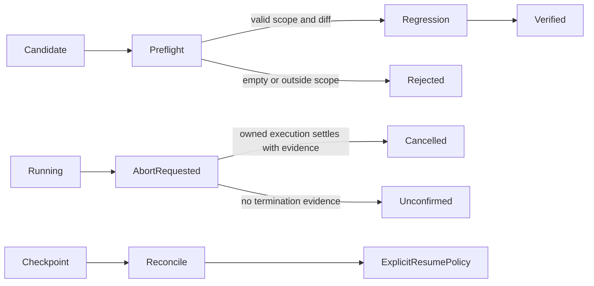

# MNEMOS Agent Runtime

Selected runtime components from **MNEMOS**, an independent AI orchestration project by [Andris Ziemelis](https://github.com/aziemels-byte).

This repository focuses on a practical harness problem: how to distinguish requested work, running work, verified results and uncertain termination. It contains a small, adapted code sample with tests and an executable example. It does not include the full MNEMOS system.

## Run it

Requires Node.js 24 or later. There are **no external runtime or development dependencies** and no API keys to configure.

```sh
npm test
npm run demo
npm run check:publication
node examples/lease-and-idempotency.mjs
node examples/quality-gate.mjs
```

The demo creates a temporary workspace, rejects an empty candidate without starting regression, validates an actual code change in a child Node.js process, starts and cancels an owned child process, saves a checkpoint, and launches a **fresh Node.js process** to reconcile the cancelled attempt and explicitly complete a report. It cleans up its temporary files.

## Components

| Component | Responsibility | Important boundary |
| --- | --- | --- |
| `createCandidateVerifier` | Validate allowed paths and a non-empty candidate before regression | The workspace adapter must report every changed path; the verifier is not a filesystem sandbox |
| `PhaseJobRegistry` | Track job identity and execution phase; propagate abort; wait for an owned settlement | A cancellation request or timeout alone is not confirmed termination |
| `classifyProviderFailure` | Separate authentication, quota, model, timeout and transport failures; redact known credential patterns | It never retries, changes accounts or silently selects another model |
| `GoalRecoveryCoordinator` | Restore a checkpoint and reconcile each recorded job | Restoring state never automatically replays a task |
| `FileCheckpointStore` | Bound JSON size and atomically replace a checkpoint file | Writes are serialized within one store instance; multi-process locking is out of scope |
| `IdempotencyRegistry` | Journal effect intent and prevent ambiguous retries | Durable safety requires a caller-provided persistent journal; external reconciliation is required for UNKNOWN |
| `ResourceLeaseManager` | Reserve named resources exclusively with expiring leases | Single-process registry; not a distributed lock or permission to execute compute |
| `QualityGate` | Fail-closed evaluation of candidate test receipts and regression metrics | Read-only decision; human review is mandatory and supplied evidence is not authenticated |
| `QualityFloorPolicy` | Propose routes meeting a minimum expected quality threshold | Does not execute providers or validate forecast calibration |



## Example API

```js
import { createCandidateVerifier } from './src/index.mjs';

// Your runner must wait for actual exit and return { passed, exitCode }.
const verify = createCandidateVerifier({ runRegression: runYourTestRunner });

const result = await verify({
  workspace: yourWorkspaceAdapter,
  allowedFiles: ['src/task.mjs'],
  signal: yourAbortController.signal
});
```

The snippet shows the interface. The [runnable example](examples/verify-candidate.mjs) supplies a real file adapter and executes a real regression check. A production adapter must include tracked changes, deletions, renames and untracked files in its inventory, using repository-relative forward-slash paths. A `passed` flag without a zero exit code does not verify a candidate.

## Additional safety examples

Run `node examples/lease-and-idempotency.mjs` for a synthetic resource lease and a deduplicated operation. The idempotency adapter accepts `appendEvent(type, key, { record })` and `listEvents({ typePrefix })`; records may include results and must be kept in private storage. No store means process-local deduplication only. Request fingerprints are based on JSON serialization, so callers must use stable request shapes.

The lease manager requires a `nodeRegistry.require(nodeId)` adapter whose nodes declare VERIFIED trust and AVAILABLE status. Leases are in-memory, exclusive per node and resource, and require explicit caller authorization. This is not a cross-process lock, remote permission grant, or GPU scheduler.


## Quality Gate

MNEMOS includes a standalone, **read-only** quality gate for agent-generated change candidates. The public extraction combines concepts from five private modules; it does not expose the production orchestration code.

\`\`\`js
import { QualityGate } from './src/index.mjs';

const decision = new QualityGate().review({
  definition: {
    executionPolicy: { requiresIsolatedWorktree: true },
    approvalPolicy: { autoMerge: false }
  },
  checks: { unit: unitReceipt, integration: integrationReceipt,
    regression: regressionReceipt, benchmark: benchmarkReceipt,
    security: securityReceipt, recovery: recoveryReceipt },
  baseline: baselineMetrics,
  candidate: candidateMetrics
});
\`\`\`

Each required receipt must contain \`passed: true\`, \`completed: true\`, \`exitCode: 0\` and a non-empty \`evidenceId\`. Metrics require equal positive sample counts, finite success rate, quality, cost and latency, and nonnegative regression counts. Only non-regressing candidates with all required receipts return \`READY_FOR_HUMAN_REVIEW\`. The optional release qualification checks eight additional categories with traceable evidence. \`QualityFloorPolicy\` proposes candidate routes above a configured quality threshold without executing any provider.

Run the synthetic example with \`node examples/quality-gate.mjs\`. The package does **not** run tests, authenticate external receipts, attest that a real worktree was isolated, establish benchmark equivalence, merge code or deploy changes. A trusted caller must supply real results and independently enforce policy; passing this gate is not a production safety certification.


## Design decisions and limits

- Cheap structural checks run before expensive tests. Malformed paths fail instead of disappearing from the allowed-scope check.
- Cooperative cancellation is distinct from killing an operating-system process. The registry trusts a caller-owned execution adapter's termination evidence. The demo proves termination of one owned child, not arbitrary descendant trees or remote jobs.
- Registry idempotency lasts only while an entry remains in that in-memory registry. Cross-process exactly-once execution is not claimed.
- Checkpoints are versioned and bounded to 1 MiB. Malformed state and failed job inspection require reconciliation. Stored state is not an instruction to execute work.
- Checkpoint files use same-directory replacement and a flushed temporary file. This is not a claim of multi-host durability, directory-fsync guarantees or protection against an attacker controlling the state directory. Use an owner-controlled directory. Unix permission bits do not replace Windows ACLs.
- Diagnostic redaction recognizes selected credential patterns. It is best-effort and does not make arbitrary logs or personal data safe to publish.
- Idempotency and leases do not supply exactly-once execution across arbitrary processes. A failed or lost effect receipt is UNKNOWN until authoritative reconciliation. A successful remote resource lease does not permit remote execution by itself.
- No model quality, token savings, benchmark score or commercial production scale is claimed by this sample.

## Provenance

These modules were selected from MNEMOS execution, orchestration, recovery and diagnostic code, then adapted to remove private runtime dependencies and improve reviewability. The public APIs and tests differ from the private application. See [PROVENANCE.md](PROVENANCE.md) for the extraction boundaries and changes.

The project was developed with AI-assisted tooling. This sample is presented with runnable checks and explicit limitations; generated code alone is not validation.

## Rights

Copyright 2026 Andris Ziemelis. This is a public portfolio sample with **all rights reserved**, not a permissively licensed open-source release. See [LICENSE](LICENSE). No package is published to npm.
